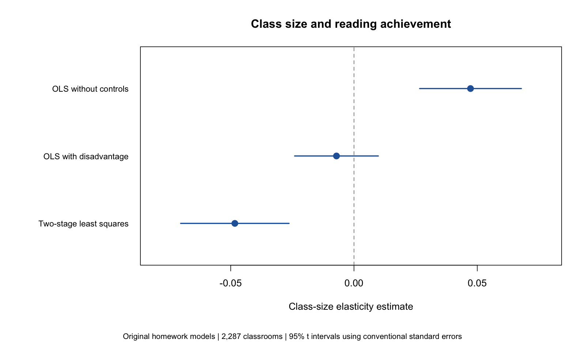
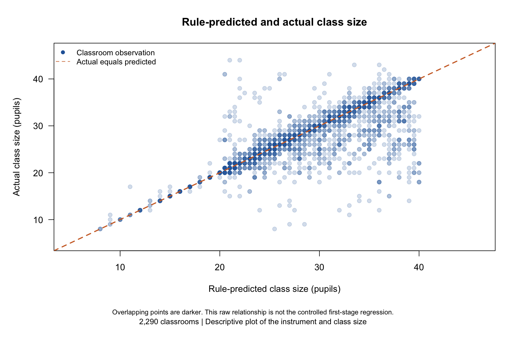

# Results from the original coursework models

These files summarize the models in the repository's original `analysis.R`. No additional models or controls were introduced. The original R script has not been changed to save these files automatically.

- `model_summaries.txt`: Output from the original OLS, adjusted OLS, first-stage, and two-stage least squares models, using `AER` as in the homework.
- `regression_results.csv`: Coefficients, conventional standard errors, t statistics, p-values, observation counts, and approximate 95% confidence intervals using residual-degrees-of-freedom t critical values.
- `model_fit.csv`: Model sample sizes, excluded rows, residual degrees of freedom, and R-squared values.

The three reading-score models use 2,287 classrooms. Three rows have missing reading scores. The first-stage model uses all 2,290 classrooms, matching the original code.

The standard errors are the conventional defaults from the original analysis. They are not heteroskedasticity-robust or school-clustered. A causal interpretation of the IV estimate depends on the identifying assumptions and cannot be established from a strong first-stage relationship alone.

## Figures

The figures were prepared separately with coding assistance to display the original results and supplied data. They are not figures from the original homework submission and are not automatically generated by `analysis.R`.

The second figure is an unadjusted descriptive plot, not the first-stage regression controlling for student disadvantage. Overlapping classroom observations appear darker. The raw course dataset is not included.
